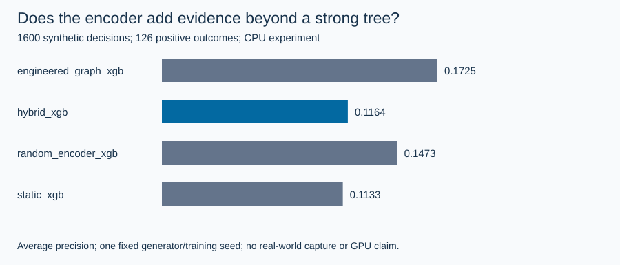

# Hybrid Fraud GNN | Vedant Thaker

I wanted to know whether learning a graph embedding was worth the extra training step for a fraud review team. A shared device seemed like a fair test. It could connect a ring of accounts, or it could just be a busy public terminal. If I had 80 review slots, which signals would help me fill them?

On the held-out synthetic transactions, XGBoost found **19 positives** using simple graph statistics and **10** using embeddings from the trained encoder. Keeping the encoder at its random starting weights yielded **16**. Static features alone found **7**. If I’d stopped at the comparison with the static model, I’d have given the training step credit for finding three extra cases. The untrained control is why I’d keep that conclusion open. [Held-out predictions](results/predictions.csv) · [Model comparison](results/case-study.md)

## What each tree knew

I froze the graph at midnight using the previous seven days of customer and device observations. A transaction can change tomorrow’s graph, never its own features. I also held out entire customer and device cohorts. The encoder has to use attributes and neighbors to represent a new account, because it has no learned lookup table of customer IDs.

```text
prior seven days of customer/device observations    current transaction
                  |                                         |
       time-frozen bipartite graph                  static/profile/history
                  |                                         |
       2 learned mean-SAGE layers                           |
                  |                                         |
        customer/device embeddings --------------------------+
                                    |
                          actual CPU XGBoost
                                    |
                      fixed daily review capacity
```

I kept the XGBoost configuration and daily review budget fixed across all four inputs. The test contains 1,600 decisions and 126 positives. Across its second half, after the simulated fraud pattern changed, simple graph statistics found seven positives in 40 reviews, the trained embeddings found four, and static features found zero. The generator deliberately creates shared-device patterns. Another population could give a different ordering. [Results by period](results/metrics.json) · [Data generation and limitations](DATA_CARD.md)



## Notes to self

Keep the untrained encoder in the next run. Before spending time on more layers, I’d repeat the comparison across seeds and check which cases move into and out of the 80 slots. A reviewer can ask what happened on a shared device in the last week. I’d want the extra training and scoring cost to buy more useful cases than that simple starting point. [Experiment design and sources](METHOD.md)

## Reproduce the CPU run

Use Python 3.11 in an isolated environment.

```powershell
python -m venv .venv
.venv\Scripts\Activate.ps1
python -m pip install torch==2.9.1 --index-url https://download.pytorch.org/whl/cpu
python -m pip install -r requirements.txt
python -m unittest discover -s tests -v
python -m hybrid_fraud demo --out runs/reproduction
python -m hybrid_fraud report --out runs/reproduction
python -m hybrid_fraud verify --out runs/reproduction
```

The default generates 4,800 synthetic transactions, trains the encoder for 50 epochs and saves the encoder and tree weights. It runs locally. The pinned Linux dependencies use CPU-only XGBoost. The reference Windows run used the full XGBoost package with CPU selected. Reports written outside the repository link back to the project files. Library versions and hardware can affect numerical results.

To run the encoder on a CUDA device, install a CUDA-enabled PyTorch build and pass `--encoder-device cuda`. The published results used CPU for both stages. The tree stage always runs on CPU.

I built this independent portfolio experiment in November 2026 using synthetic data. The results describe this simulated queue only. [Technical references](METHOD.md) · [MIT license](LICENSE)
